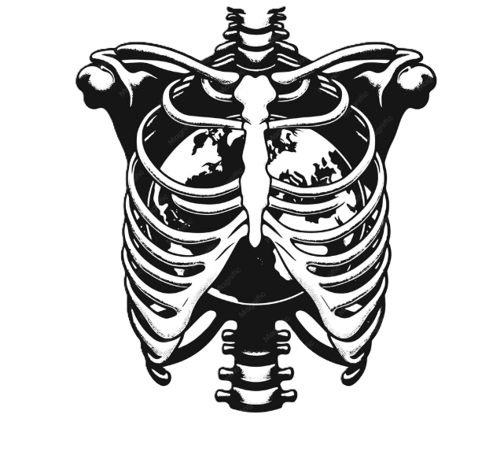
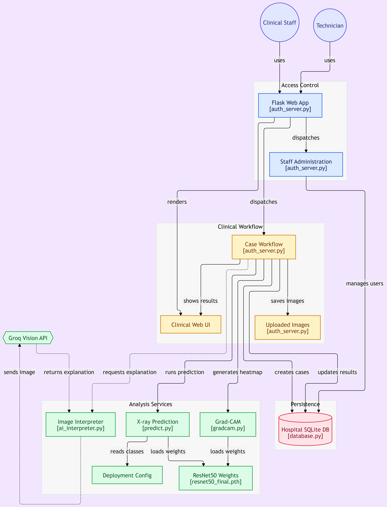

# X-RAY-IMAGE-SCANNER2
# Chest X-Ray Clinical Support System


<p align="center">
  
</p>


A Flask-based clinical support application that uses a **PyTorch ResNet-50 deep learning model** to classify chest X-ray images into four categories:

* COVID19
* NORMAL
* PNEUMONIA
* TB

The system allows users to upload X-ray images, obtain a model prediction, view Grad-CAM visualizations, store case information in a database(SQLLITE), and generate an AI-assisted interpretation using **Groq and Qwen**.

## Main Features

* Chest X-ray image upload
* ResNet-50 four-class classification
* Image preprocessing and normalization
* SQLite database for uploaded cases
* Grad-CAM visual explanations
* AI-assisted interpretation using Groq/Qwen
* Web interface built with Flask
* Git LFS support for the trained model

<h2>Project Architecture</h2>

<p align="center">
  
</p>

<p align="center">
  <b>Project Architecture of the Chest X-Ray Clinical Support System</b>
</p>

<b>X-RAY-IMAGE-SCANNER2: Chest X-Ray Clinical Support Prototype</b>


# X-RAY-IMAGE-SCANNER2

**Chest X-Ray Clinical Support Prototype**

A Flask web application that uses a fine-tuned ResNet-50 model to classify chest X-rays and give healthcare workers explainable predictions. Built with the radiologist shortage in Africa and other low-resource settings in mind.

> **Important disclaimer**
> This is a university research prototype. It is **not** a validated medical device, has **not** been clinically evaluated, and **must not** be used to diagnose or treat patients. All outputs must be reviewed by a qualified radiologist or physician.

---

## Table of Contents

- [Overview](#overview)
- [Why This Matters](#why-this-matters)
- [Quick Start](#quick-start)
- [Prerequisites](#prerequisites)
- [Installation and Setup](#installation-and-setup)
- [Main Features](#main-features)
- [Usage](#usage)
- [Troubleshooting](#troubleshooting)
- [Dataset](#dataset)
- [Model Architecture](#model-architecture)
- [Model Performance](#model-performance)
- [Explainability: Grad-CAM](#explainability-grad-cam)
- [Calibration and Confidence](#calibration-and-confidence)
- [Model Development and Evaluation](#model-development-and-evaluation)
- [Known Limitations and Future Work](#known-limitations-and-future-work)
- [Security and Privacy](#security-and-privacy)
- [Project Structure](#project-structure)
- [Technologies and Stack](#technologies-and-stack)
- [Contributing](#contributing)
- [Support and Contact](#support-and-contact)
- [Citation](#citation)
- [License](#license)
- [References and Resources](#references-and-resources)
- [Team](#team)
- [Acknowledgments](#acknowledgments)
- [FAQ](#faq)

---

## Overview

The system classifies a chest X-ray into one of four classes:

| Class | Label |
|-------|-------|
| COVID-19 | `COVID-19` |
| Tuberculosis | `TB` |
| Pneumonia | `Pneumonia` |
| Normal | `Normal` |

Beyond the model itself, the application adds:

- Calibrated confidence scores
- Grad-CAM visual explanations
- AI-generated plain-language image descriptions
- Role-based access control
- Case management with an audit trail

Together these turn a trained model into a usable prototype tool.

---

## Why This Matters

**The diagnostic gap**

- Sub-Saharan Africa has far fewer radiologists per million people than Europe.
- South Africa has a limited number of registered radiologists for its population.
- South Africa records a very large number of new TB cases each year (see the WHO Global TB Report).
- A meaningful share of South African TB patients are also HIV co-infected, which can make chest X-rays harder to interpret.
- Even expert radiologist reads contain a measurable error rate.

**Our approach:** an AI second reader that flags likely disease, highlights the image regions that influenced its decision, and defers to humans when uncertain.

---

## Quick Start

```bash
# 1. Clone and set up the environment
git clone <repository-url>
cd <repository-folder>
python3 -m venv .venv
source .venv/bin/activate        # Windows: .venv\Scripts\activate

# 2. Install dependencies and download the model
pip install -r requirements.txt
git lfs pull

# 3. Configure the Groq API key
export GROQ_API_KEY="your_key_here"

# 4. Run the application
python auth_server.py
```

Then open <http://localhost:5000> and log in with your Staff ID.

---

## Prerequisites

| Requirement | Version | Where to get it |
|-------------|---------|-----------------|
| Python | 3.10 or newer (3.8 is end-of-life and unsupported by recent PyTorch) | <https://www.python.org/downloads/> |
| pip | Latest | Bundled with Python |
| Git | Latest | <https://git-scm.com/downloads> |
| Git LFS | Latest | <https://git-lfs.com/> |
| Groq API key | Free tier available | <https://console.groq.com/> |

---

## Installation and Setup

### Step 1: Clone the repository

```bash
git clone <repository-url>
cd <repository-folder>
```

### Step 2: Create a virtual environment

**macOS / Linux**

```bash
python3 -m venv .venv
source .venv/bin/activate
```

**Windows (PowerShell)**

```powershell
python -m venv .venv
.venv\Scripts\Activate.ps1
```

**Windows (Command Prompt)**

```bat
python -m venv .venv
.venv\Scripts\activate
```

### Step 3: Install dependencies

```bash
pip install --upgrade pip
pip install -r requirements.txt
```

### Step 4: Download the trained model

```bash
git lfs install
git lfs pull
```

> **Note:** If Git LFS is not installed, download the model from the Releases page and place it at `models/resnet50_xray.pth`.

### Step 5: Configure the Groq API key

The AI interpretation feature needs a free Groq API key. Get one at <https://console.groq.com/>.

**macOS / Linux**

```bash
export GROQ_API_KEY="your_groq_api_key_here"
```

**Windows (PowerShell)**

```powershell
$env:GROQ_API_KEY = "your_groq_api_key_here"
```

**Windows (Command Prompt)**

```bat
set GROQ_API_KEY=your_groq_api_key_here
```

**For team environments (GitHub Codespaces)**

1. Go to **Repository > Settings > Secrets and variables > Codespaces**.
2. Click **New repository secret**.
3. Name: `GROQ_API_KEY`
4. Value: your Groq API key (each team member should use their own).

### Step 6: Run the application

```bash
python auth_server.py
```

Log in with a staff account created for you by the technician.


## Main Features

### 1. Image analysis

- Chest X-ray upload (JPG, JPEG, PNG)
- ResNet-50 four-class classification (96.24% accuracy on the held-out test set)
- Calibrated confidence scores with automatic uncertainty flagging

### 2. Explainability

- Grad-CAM heatmaps showing which regions influenced the prediction
- Layer comparison (layer3 vs layer4) for resolution checks
- AI-assisted plain-language interpretation using Groq and a Qwen LLM

### 3. Case management and audit trail

- SQLite database of cases and predictions
- Unique case ID, timestamp, prediction and confidence for every case
- Automatic "Review recommended" flag for low-confidence cases
- Case history searchable by date, prediction and status

### 4. Oversight

- Statistics dashboard (total analysed, pending, failed)
- Diagnosis breakdown visualisation
- Flagged cases consolidated in one reports view
- Staff login with role-based access control

### 5. Lightweight deployment

- Raw model inference of about 5.56 ms per image
- 89.7 MB on disk, 23.5M parameters
- Git LFS for model distribution
- Flask web interface; the classifier needs no separate inference server

---

## Usage

### Log in

| Field | Value |
|-------|-------|
| Username | Staff ID (configured by the technician) |
| Password | Staff password (configured by the technician) |

Access is restricted to authorised personnel.

### Analyse a new X-ray

1. Click **New X-Ray Analysis**.
2. Upload a chest X-ray image (JPG, JPEG or PNG).
3. Wait for processing. The classifier itself takes milliseconds; Grad-CAM and the AI explanation add a few seconds depending on hardware and network.
4. Review the results:

| Result | Meaning |
|--------|---------|
| Prediction | COVID-19, TB, Pneumonia or Normal |
| Confidence score | Calibrated model certainty (0-100%) |
| Status | "Proceed", or "Review recommended" if calibrated confidence is below 90% |
| Grad-CAM heatmap | Visual explanation overlay |
| AI explanation | Plain-language description of the findings |

### Review case history

1. Click **Analysis History**.
2. Browse previous cases by date, prediction or confidence.
3. Search and filter by case ID or diagnosis.

### View statistics and reports

1. Click **Reports and Statistics**.
2. See total cases, diagnosis breakdown and pending reviews.
3. Identify cases flagged for human review.

### Manage staff (technician only)

1. Click **Technician Dashboard**.
2. Add, update or deactivate staff accounts.
3. Manage access permissions.

---

## Troubleshooting

### `ModuleNotFoundError: No module named 'torch'`

Activate your virtual environment and reinstall the dependencies:

```bash
source .venv/bin/activate        # macOS / Linux
pip install -r requirements.txt --force-reinstall
```

### "Model file not found" or Git LFS error

```bash
git lfs install
git lfs pull
```

If it still fails, download the model manually from Releases and place it at `models/resnet50_xray.pth`.

### "GROQ_API_KEY not found"

Check that the variable is set. The command prints the key, so do not share the output.

```bash
echo $GROQ_API_KEY               # macOS / Linux
echo %GROQ_API_KEY%              # Windows (Command Prompt)
```

If it is empty, set it again and restart the application.


## Dataset

**Source:** Chest X-Ray dataset (4 categories: COVID-19, Pneumonia, Tuberculosis, Normal) by Pritpal Singh on Kaggle, listed under the Apache 2.0 license.
Link: <https://www.kaggle.com/datasets/pritpal2873/chest-x-ray-dataset-4-categories>

### Statistics

| Item | Value |
|------|-------|
| Total images | 7,132 (6,736 after cleaning) |
| Train / Validation / Test | 4,715 / 1,010 / 1,011 (70/15/15 stratified split) |
| Imbalance ratio | 7.42 : 1 |

| Class | Share of data |
|-------|---------------|
| Pneumonia | 60% (majority) |
| Normal | 22% |
| Tuberculosis | 10% |
| COVID-19 | 8% (minority) |

### Data cleaning

- **Corruption check:** all 7,132 files verified, 0 corrupted
- **Duplicate detection:** MD5 hashing removed 40 exact duplicates
- **Quality filtering:** per-class sharpness filtering (bottom 5%) removed 356 images
- **Orientation check:** rotation/symmetry audit for consistent framing

### Preprocessing pipeline

1. **Border crop:** 5% margin trim to remove scanner labels and edge artefacts
2. **Resize** to 224x224 (ResNet-50 input size)
3. **ImageNet normalisation** (matches the pretrained backbone)
4. **Augmentation (training only):** random horizontal flip and +/-10 degree rotation

---

## Model Architecture

### Why ResNet-50?

- Residual (skip) connections enable stable training at depth.
- ImageNet pretrained weights speed up convergence on small medical datasets.
- At 89.7 MB it is practical for modest hospital hardware.
- Marginally better validation metrics than a DenseNet-121 baseline.

### Details

| Item | Value |
|------|-------|
| Input | 224 x 224 x 3 RGB images |
| Backbone | ResNet-50 (ImageNet pretrained) |
| Stem | 7x7 convolution + max-pool |
| Residual stages | 4 stages with 3, 4, 6, 3 bottleneck blocks |
| Output head | Fully-connected layer, 4-way classification |
| Total parameters | 23.5M |
| Loss | Class-weighted cross-entropy (inverse-frequency weighting) |

### Training

| Setting | Value |
|---------|-------|
| Optimiser | Adam, initial learning rate 1e-4 |
| Scheduler | ReduceLROnPlateau (factor 0.5, patience 2) |
| Batch size | 32 |
| Max epochs | 15, with early stopping (patience 3 on validation loss) |
| Stopped at | Epoch 5 (best validation loss 0.108 at epoch 2) |
| Final accuracy | Validation 96.1%, training 97% |

---

## Model Performance

Evaluated once on the held-out test set (1,011 images).

| Metric | Value |
|--------|-------|
| Test accuracy | 96.24% |
| Weighted F1-score | 0.9625 |
| ROC-AUC (weighted, one-vs-rest) | 0.9966 |
| Macro F1-score | 0.9625 |
| Model size | 89.7 MB |
| Raw inference time | 5.56 ms/image |

### Per-class results

| Class | Precision | Recall | Notes |
|-------|-----------|--------|-------|
| COVID-19 | 0.99 | 0.95 | Minority class; small test sample |
| Tuberculosis | 0.96 | 1.00 | No missed TB cases in this test set (small sample; not a guarantee) |
| Pneumonia | 0.94 | 0.96 | Some confusion with Normal |
| Normal | 0.91 | 0.94 | Weakest class; most confusion with Pneumonia |

---

## Explainability: Grad-CAM

Every prediction includes a Grad-CAM heatmap showing which image regions most influenced the model's decision.

> Grad-CAM shows **where** the model attended, not **why** in a clinical sense. Attention on a plausible region does not prove a correct finding.

### Observations

- For many correct predictions, attention falls on plausible lung regions (for example the lower-right lung field for pneumonia, upper lobes for TB, bilateral involvement for COVID-19).
- Normal-class images showed elevated central attention at layer4.
- Re-analysis at layer3 (finer resolution) reduced central attention from 68.8% to 37.2%, suggesting part of the central bias was a resolution artefact, though some remains.

**Planned improvement:** restrict attention analysis to lung-field regions (lung segmentation masks) to further reduce central-attention bias.

---

## Calibration and Confidence

Raw softmax scores from neural networks are often overconfident, which is a risk in clinical settings.

### Temperature scaling

- **Temperature (T):** 1.276, fitted on the validation set
- **Purpose:** rescale confidence to better match true correctness probability
- **Effect:** confidence is reduced for high-confidence predictions. In a simple two-class approximation a raw 90% becomes roughly 85%; the exact change depends on the full set of class scores.

### Per-class decision thresholds

| Class | Threshold strategy |
|-------|--------------------|
| COVID-19, TB | Tuned to favour recall (catching true cases) |
| Pneumonia | Balanced precision and recall |
| Normal | Conservative, to avoid labelling sick patients as normal |

### Uncertainty flagging

- **Threshold:** 90% calibrated confidence
- Predictions below this are flagged **"Review recommended"**.
- High confidence does not guarantee correctness; every result still needs clinician review.

---

## Model Development and Evaluation

### Data split strategy

- Stratified 70/15/15 split preserving class proportions
- No file-level overlap between train, validation and test sets (near-duplicate leakage is not ruled out; see [Dataset](#dataset))
- Final evaluation on the test set only

### Metrics

| Metric | What it tells you |
|--------|-------------------|
| Accuracy | Overall percent correct (can mislead on imbalanced data) |
| Precision and recall | Per-class performance |
| Weighted F1 | Per-class F1 averaged by class size |
| Macro F1 | Per-class F1 averaged equally (sensitive to minority-class failure) |
| ROC-AUC | Ability to rank true positives above negatives |
| Confusion matrix | Breakdown of all errors |

**Why report both weighted and macro metrics?** Pneumonia makes up about 60% of the data and COVID-19 about 8%. Accuracy and weighted F1 are dominated by the majority class, so a model that predicted "Pneumonia" for everything would still score around 60% accuracy and look deceptively reasonable. Macro-averaged metrics and per-class precision/recall expose weak performance on minority classes, so read them all together.

---

## Known Limitations and Future Work

### Known limitations

1. **Normal vs Pneumonia confusion**
   - Normal: 91% precision, 94% recall
   - Most common errors: Pneumonia predicted as Normal (20 cases), Normal predicted as Pneumonia (13 cases)
   - Grad-CAM shows elevated central-lung attention on Normal images
2. **Single public dataset**
   - One Kaggle dataset (7,132 images before cleaning)
   - No multi-hospital or multi-scanner validation
   - May not generalise to other equipment or patient populations
3. **Minority class size**
   - COVID-19 is only about 8% of the data (545 images) with limited diversity
4. **Possible near-duplicate leakage** between splits (only exact duplicates were removed)
5. **No clinical evaluation** against radiologist readers

### Future improvements

- [ ] Multi-site validation with South African hospital data
- [ ] Near-duplicate detection (perceptual hashing) and re-evaluation
- [ ] Targeted augmentation for Normal vs Pneumonia
- [ ] Lung-field attention masking
- [ ] Prospective evaluation alongside clinician readers
- [ ] Mobile and offline deployment for rural and mobile-clinic settings
- [ ] Ensembles with other architectures
- [ ] Active learning to prioritise high-uncertainty cases


## Security and Privacy

### Access control

- Staff login required
- Role-based permissions:

| Role | Permissions |
|------|-------------|
| Clinical staff | View and upload cases, see analysis history |
| Technician | Manage user accounts and system settings |

- Audit trail: uploads, predictions and reviews are logged with timestamps
- Remove or change any default/demo credentials before deployment

### Data handling

- Cases and predictions are stored in a local SQLite database.
- API keys are read from environment variables and never hard-coded.


### Compliance considerations

- Follow the data protection laws that apply to you, such as POPIA (South Africa), GDPR or HIPAA.
- Configure access controls, audit trails and retention policies to meet your institution's requirements.
- Do not upload identifiable patient data to a prototype system without ethics approval and appropriate agreements.

---

## Project Structure

```text
<repository-folder>/
├── auth_server.py            # Main Flask application
├── models/
│   └── resnet50_xray.pth     # Trained model weights (Git LFS)
├── data/
│   ├── train/                # Training images (stratified split)
│   ├── val/                  # Validation images
│   └── test/                 # Test images
├── src/
│   ├── preprocessing.py      # Image loading, resizing, normalisation
│   ├── model.py              # ResNet-50 architecture and inference
│   ├── gradcam.py            # Grad-CAM explainability
│   ├── database.py           # SQLite case management
│   ├── calibration.py        # Temperature scaling and confidence thresholds
│   └── groq_integration.py   # Groq/Qwen LLM integration
├── templates/
│   ├── login.html            # Staff login page
│   ├── upload.html           # Image upload and analysis
│   ├── history.html          # Case history view
│   ├── reports.html          # Statistics and flagged cases
│   └── technician.html       # Staff management dashboard
├── static/
│   ├── css/                  # Styling
│   └── js/                   # Client-side interactivity
├── requirements.txt          # Python dependencies
├── README.md                 # This file
├── LICENSE                   # Apache 2.0 license text
└── .gitattributes            # Git LFS configuration for the model
```

> **T

## Technologies and Stack

| Area | Tools |
|------|-------|
| Core ML | PyTorch, torchvision, ResNet-50 (ImageNet pretrained, fine-tuned for 4 classes), NumPy, Pandas, scikit-learn; trained on Kaggle GPU notebooks |
| Data and explainability | Pillow, OpenCV, Laplacian variance (sharpness), MD5 hashing (exact duplicates), Matplotlib, Seaborn, Grad-CAM (layer3 and layer4 analysis) |
| Deployment | Flask, SQLite (case management and audit trail), Flask-Login (authentication and role-based access), Groq API with Qwen model (AI explanations), PyTorch on CPU/GPU |
| DevOps | Git, Git LFS, pip and virtual environments, environment variables for secrets |

---

## Contributing

Contributions are welcome. Please follow the guidelines below.

### Reporting bugs

- Check existing issues first.
- Provide a clear title, description and steps to reproduce.
- Include Python version, OS and error messages.

### Suggesting features

- Open an issue tagged `enhancement`.
- Describe the use case and expected behaviour.
- Link relevant research or clinical guidelines if applicable.

### Submitting code

1. Fork the repository.
2. Create a branch: `git checkout -b feature/your-feature-name`
3. Make and test your changes.
4. Commit with a clear message: `git commit -m "Add feature: description"`
5. Push: `git push origin feature/your-feature-name`
6. Open a Pull Request with a summary of changes.

### Code standards

- Follow PEP 8.
- Add docstrings to functions and classes.
- Write unit tests for new features.
- Update documentation for user-facing changes.

### Development setup

```bash
git clone <your-fork-url>
cd <repository-folder>
python3 -m venv .venv
source .venv/bin/activate
pip install -r requirements.txt
pip install -r requirements-dev.txt   # testing and linting tools
pytest                                # run tests
```

See `CONTRIBUTING.md` for detailed guidelines.

---

## Support and Contact

| Channel | Use for |
|---------|---------|
| GitHub Issues | Bug reports, feature requests |
| GitHub Discussions | General questions, ideas |
| Email | Deployment questions, partnerships: `[avellohlachwayo0828@gmail.com]` |
| Documentation | Setup, usage, troubleshooting (self-service) |

**Before reaching out:** check [Troubleshooting](#troubleshooting), search existing issues, and review the [FAQ](#faq).

**When reporting a bug, include:**

- A short title
- Steps to reproduce
- Expected vs actual behaviour
- Environment (Python version, OS, `pip freeze`)
- The full traceback, if any

---

## Citation

If you use this project in research or publications, please cite:

```bibtex
@software{xray_scanner_2026,
  title  = {X-RAY-IMAGE-SCANNER2: Chest X-Ray Clinical Support Prototype},
  author = {Sono, Nsovo and Marindi, Ganda and Hlachwayo, Avelo and Mahlaule, Mihloti},
  year   = {2026},
  url    = {https://github.com/avelohlachwayo0828-coder/X-RAY-IMAGE-SCANNER2},
  note   = {CSIT Final-Year Project, 2026}
}
```

---

## License

This project's code is released under the **Apache License 2.0**. See [LICENSE](LICENSE) for the full terms.

**Dataset:** the Chest X-Ray dataset by Pritpal Singh is listed under Apache 2.0 on Kaggle. Check the dataset page and its original image sources for the terms that apply to your use.

---

## References and Resources

### Chest X-ray classification literature

- **CheXNet:** Rajpurkar et al., "CheXNet: Radiologist-Level Pneumonia Detection on Chest X-Rays with Deep Learning" (2017)
- **ChestX-ray8:** Wang et al., "ChestX-ray8: Hospital-scale Chest X-ray Database and Benchmarks on Weakly-Supervised Classification and Localization of Common Thorax Diseases" (CVPR 2017)
- **COVID-Net:** Wang, Lin and Wong, "COVID-Net: A Tailored Deep Convolutional Neural Network Design for Detection of COVID-19 Cases from Chest X-Ray Images" (Scientific Reports, 2020)

### Dataset

- Pritpal Singh, Chest X-Ray (COVID-19, Pneumonia, Normal, Tuberculosis), Kaggle: <https://www.kaggle.com/datasets/pritpal2873/chest-x-ray-dataset-4-categories>

### South African health context

- WHO Global Tuberculosis Report: <https://www.who.int/publications/global_reports/>
- South African Thoracic Society community-acquired pneumonia guidelines: <https://pmc.ncbi.nlm.nih.gov/articles/PMC7433705/>
- Radiologist shortage: 

### Technical documentation

- He et al., "Deep Residual Learning for Image Recognition" (2015)
- Selvaraju et al., "Grad-CAM: Visual Explanations from Deep Networks via Gradient-based Localization" (2016 / ICCV 2017)
- PyTorch: <https://pytorch.org/docs/stable/index.html>
- Flask: <https://flask.palletsprojects.com/>

---

## Team

**CSIT Final-Year Project 2026, Red Team**

- Nsovo Sono
- Ganda Marindi
- Avelo Hlachwayo
- Mihloti Mahlaule

---

## Acknowledgments

- **Dataset:** Pritpal Singh (Kaggle)
- **Frameworks:** PyTorch, Flask, scikit-learn
- **Research:** CheXNet, COVID-Net and the wider chest X-ray classification literature
- **Clinical context:** WHO Global TB Report, South African Thoracic Society

---

## FAQ

**Is this a diagnostic tool or a clinical support tool?**
Neither is validated. It is a research prototype intended to explore clinical support. It flags likely findings and highlights evidence, but a qualified radiologist or physician must make every diagnosis. Never rely solely on AI predictions.

**What if the system says "Review recommended"?**
Calibrated confidence is below 90%, so a clinician should review the case. Predictions above 90% also need clinician review.

**Can I run this on my hospital's equipment?**
The model is lightweight (about 90 MB) and runs on CPU or GPU. Using it with real patients would require ethics approval, clinical validation and regulatory compliance. PACS integration is not included.

**Can I retrain the model on my own data?**
In principle, yes. You would need labelled X-rays (ideally well over 1,000 per class) and preferably a GPU. See the training notebook/script once it is added to the repository.

**What about patient data privacy?**
See [Security and Privacy](#security-and-privacy). Review exactly what is stored locally and what is sent to the Groq API before using any real patient data.

**Does it work on mobile or tablets?**
The web app is intended to be responsive and usable on tablets. Offline and mobile apps are future work.

**How do I contribute or report bugs?**
See [Contributing](#contributing) and [Support and Contact](#support-and-contact).

---

*Last updated: October 2026*
*Maintainers: Red Team (Nsovo Sono, Ganda Marindi, Avelo Hlachwayo, Mihloti Mahlaule)*
*Status: Research prototype; not clinically validated*
